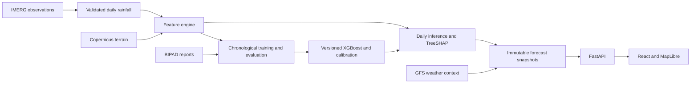

# Nepal Landslide Watch

An end-to-end research observatory for Nepal: real satellite rainfall and terrain → a trained XGBoost model → versioned daily estimates → a FastAPI service → an interactive React/MapLibre map.

**The working model ranks the likelihood of a BIPAD landslide report at its recorded location. The map displays a relative hazard percentile, not a physical landslide probability.** Reports have uncertain coordinates, triggers and coverage. This distinction is part of the product, not a footnote. The application is experimental and is not an official emergency warning service.

## Open the existing project

The supplied workspace already contains the downloaded data, fitted model, evaluation artifacts and ten real historical simulation runs. Python 3.13 and Node 22 were used.

```sh
cd /Users/sushil/Desktop/Ishika2
make build
NEPAL_WORKER_ENABLED=1 make serve
```

Open **http://localhost:8000**. API documentation is at **http://localhost:8000/docs**. Stop the process with Ctrl+C. Use `make serve` without the environment variable to inspect existing runs without starting downloads. The computer must remain awake for the local worker to update data and issue forecasts.

If dependencies are missing, first run `make setup`. On Apple Silicon, setup applies the documented XGBoost OpenMP library-path fix using the OpenMP runtime distributed with scikit-learn; no system libraries are replaced.

## What works

- A real Nepal boundary, 1,536 clipped 0.1° cells, terrain relief, graded hazard colors, zoom and layer controls.
- Search across 87,906 real Nepal populated-place records or by latitude/longitude.
- Select a cell for its percentile, rainfall history, terrain and input freshness.
- Change the target date to inspect archived estimates; overlay catalogue reports for the selected day.
- Review data provenance and the project background in the application; measured performance and limitations are documented in the research report.
- Refresh rainfall every 30 minutes, publish a new versioned daily forecast before the target day, and discover new publications in the browser automatically.
- Keep unavailable values unavailable. Source failures, stale worker heartbeats, simulated dates and expired operational runs are represented explicitly.

Historical archive runs currently cover July 1–7, 2025 and September 6–8, 2026. They are **retrospective simulations generated during development**, not forecasts issued on those dates. The initial September 8 map is also a simulation: the project was built after that day's midnight.

## Scientific result

The chronological 2025 test contains 537,600 cell-days and 544 reported-positive cell-days. The selected model was fitted on 2018–2023, with tuning in 2023 and calibration/thresholds in 2024. The first fifteen days of calibration and evaluation years are excluded to separate antecedent windows. Preliminary 2025 results were inspected during development; new research decisions require a new holdout or prospective confirmation.

| Measurement | Result |
| --- | ---: |
| Average precision, terrain + season + rainfall XGBoost | 0.007166 |
| Average precision, terrain + season XGBoost | 0.006792 |
| Relative AP improvement from rainfall | 5.50% |
| ROC AUC | 0.8720 |
| Reported-positive cells detected at the frozen 95th-percentile threshold | 205 / 544 (37.68%) |
| Fraction of test cell-days alerted | 5.09% |
| Alerts without a matched report | 27,172 / 27,377 (99.25%) |

Rainfall provides a modest incremental ranking gain in this experiment; the gain is not established as statistically reliable. Unmatched alerts are not all verified physical false alarms because the inventory is incomplete. Absolute precision is still far too low to claim a validated warning system. See the [full research report](docs/RESEARCH.md), including calibration, spatial generalization, uncertainty, ablations and reproducible figures.

## Update timing

Each target is a fixed Nepal calendar day, 00:00–00:00 in `Asia/Kathmandu`. The worker attempts issuance at **23:50 Nepal time on the previous day**. Rainfall features end at the previous day's **12:00 UTC**, which is 6 h 15 min before target-day midnight and 6 h 5 min before scheduled issuance.

IMERG publishes half-hour estimates with processing and replica delays. The worker checks the source every 30 minutes, but the model issues daily because the labels do not establish exact failure hours. The browser checks for a new publication every 60 seconds. A source refresh does not rewrite a previously published daily estimate.

Exactly 48 finite half-hours are required for each daily rainfall value, and 14 complete daily intervals for each prediction. The scheduler withholds a daily national publication if required cells are incomplete. During the issuance window it can use a complete cached window after a refresh failure, while preserving the degraded source status. A missed window is not backdated. GFS context is fetched before the issuance window and never blocks the trained model's publication.

## Real inputs

| Source | Resolution / cadence | Role and access |
| --- | --- | --- |
| [BIPAD incident API](https://bipadportal.gov.np/api/v1/incident/?hazard=17&limit=10000&ordering=id) | Point reports, day-level labels, irregular reporting | 6,142 landslide reports; public API; primary target. Approval does not establish precise coordinates or rainfall triggers. |
| [NASA COOLR](https://gis.earthdata.nasa.gov/portal/rest/services/Landslides/COOLR_Reports_Points/FeatureServer/0) | Point reports with heterogeneous uncertainty | 587 Nepal reports; public ArcGIS service; catalogue/map context, excluded from the primary training labels. |
| [NASA IMERG Early via dynamical.org](https://dynamical.org/catalog/nasa-imerg-analysis-early/) | 0.1°, half-hourly; latency must be measured | Public anonymous Icechunk/S3 replica. Acquired 2018–2025 history and recent observations; rainfall features. Historical data are reprocessed, not original as-issued inputs. |
| [Copernicus GLO-90](https://registry.opendata.aws/copernicus-dem/) | Approximately 90 m, static 2021 release | Public DSM tiles; median elevation/slope, upper slope, relief and steep fraction aggregated to cells. |
| [NOAA GFS](https://registry.opendata.aws/noaa-gfs-bdp-pds/) | 0.25°, initialized every six hours | Public GRIB byte ranges; target-day forecast precipitation shown as context only. The fitted model does not use it. |
| [geoBoundaries Nepal](https://www.geoboundaries.org/api/current/gbOpen/NPL/ADM0/) | Simplified ADM0 boundary | Public CC BY 4.0 boundary; prediction grid clipping. |
| [GeoNames Nepal](https://download.geonames.org/export/dump/NP.zip) | Place coordinates, periodically updated | Public CC BY 4.0 place search and nearby place labels, not model inputs. |

The current input manifest records exact URLs, retrieval times and hashes. NASA's 2026 V07C input differs from the V07B historical archive, and predictions are flagged for prospective validation. No soil moisture is substituted or invented: SMAP was deferred until authenticated, quality-controlled observations can be integrated with realistic availability lags. Roads, geology and land cover were not added merely to increase feature count.

Basemap credits: OpenStreetMap contributors; terrain display: Mapzen/AWS Open Data. Basemap tiles require internet access. Source licenses and attribution remain with their original providers; public access alone does not imply unrestricted redistribution of government incident records.

## Reproduce from a clean checkout

Run from the project root. This downloads real source data; it is not necessary to repeat it just to open the existing application.

```sh
make setup
make data
make terrain
make train
make evaluate
make demo
make build
NEPAL_WORKER_ENABLED=1 make serve
```

The acquisition command downloads all daily rainfall from 2018 through 2025, then appends recent complete intervals without inventing intervening dates. Terrain is built from 28 public tiles. Training uses all eligible observed cell-days and unlabeled background, without fabricated negatives or synthetic weather. On this workstation the entire cached data directory is under 400 MB; dependencies and working arrays require additional disk and memory. Allow several GB of RAM for training and time for source downloads. Network speed and source availability dominate initial acquisition.

For the retained historical rainfall revision, use the saved Icechunk snapshot rather than today's moving `main` reference:

```sh
.venv/bin/python scripts/acquire_data.py --only rain \
  --start 2018-01-01 --end 2025-12-31 \
  --snapshot-id YJXHK73EN8J3AN6EN71G --output-stem rainfall_reproduction
```

This writes a separate artifact. Exact reproduction also requires the retained event and terrain snapshots, dependency lock and matching model configuration; public catalogues can change. Preserve the current `data/` directory before reacquiring. Individual source provenance files and the model card identify the actual training inputs.

Useful commands:

```sh
# Refresh genuinely available rainfall; no simulated source values
.venv/bin/python scripts/acquire_data.py --only recent
# Fetch weather context for a specific Nepal target day
.venv/bin/python scripts/acquire_gfs.py --target-day 2026-09-09
# Reconstruct a historical estimate, clearly labeled as a simulation
.venv/bin/python scripts/publish_forecast.py 2025-07-02
# Run one scheduler cycle, respecting the real clock
.venv/bin/python scripts/run_worker.py --once
# Recompute the saved model's test predictions and scientific plots
make evaluate
# Backend checks and production frontend compilation
make test
```

The `--operational` publisher flag refuses past target days and out-of-window issuance. Use the scheduler for real forecasts. A model version and target identify an immutable publication; an old replay cannot roll the current pointer backward.

## Architecture and API



This deployment uses one Python service, one scheduler and durable atomic files. At this scale a database and a distributed queue would add account and operational burden without improving the scientific model. File locks, staged writes and immutable run IDs protect the single-node workflow. Multiple independent writers or horizontally scaled instances require shared object storage and coordinated scheduling; see [deployment instructions](docs/DEPLOYMENT.md).

| Endpoint | Response |
| --- | --- |
| `/api/status` | Current run, model availability, worker/source health and server time |
| `/api/forecast?run_id=…` | GeoJSON cells plus manifest; defaults to current publication |
| `/api/location?lat=27.7&lon=85.3&run_id=…` | Containing Nepal cell, rainfall series and score history |
| `/api/history?cell_id=…` | Published cell history |
| `/api/search?q=Pokhara` | Real place matches or coordinate interpretation |
| `/api/runs` | Published run manifests |
| `/api/model` | Scientific model card and measured evaluation |
| `/api/sources` | Source provenance |
| `/api/events?start=2025-07-01&end=2025-07-01` | Paginated, allowlisted catalogue fields |
| `/healthz` | Process liveness, not a claim that data are fresh |

`probability` is null for this percentile model. The internal calibrated catalogue-target estimate is separately named; clients must not label it physical landslide probability. See [CONTRACT.md](CONTRACT.md) for field definitions.

## Project guide

- `backend/app/sources/`: real acquisition adapters and provenance.
- `backend/app/features.py`, `terrain.py`, `modeling.py`: scientific computation.
- `backend/app/worker.py`: scheduled acquisition and prospective publication.
- `backend/app/api.py`, `storage.py`: read-only public service.
- `frontend/src/`: interactive application.
- `scripts/`: reproducible commands and deployment supervisor.
- `data/`: local source snapshots, features, model and publications. Raw reports are not served.
- `artifacts/evaluation/`: verified metrics, row-level estimates, tables and publication-quality plots.
- `docs/RESEARCH.md`: methods, results, limitations and next experiments.
- `docs/DEPLOYMENT.md`: Docker/Render deployment, runtime bundle and operations.

For an application demonstration, show a selected cell, a second historical day, the date-matched reports and the validation panel. Explain why the percentile is not a probability, what the rainfall ablation actually found, and how a prospective study could improve it. Present this as a working research prototype with candid results, not as an officially validated warning service.
